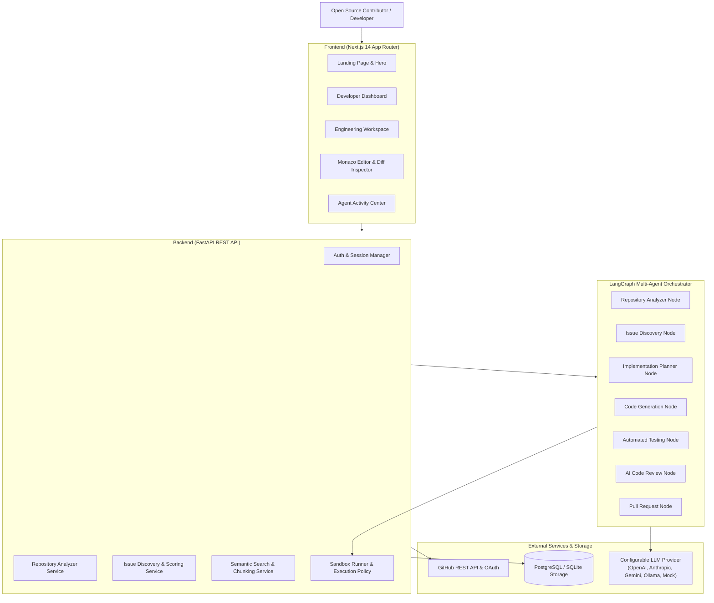

# RepoPilot AI - System Architecture

RepoPilot AI is designed as a modular, resilient multi-agent engineering platform.

## Architecture Diagram

## Key Modules

1. **Repository Analyzer**: Analyzes repository trees, dependency manifests (`package.json`, `pyproject.toml`, `Cargo.toml`), entry points, and test runners without requiring a local clone.
2. **Issue Discovery & Suitability**: Fetches real GitHub issues, parses labels, estimates difficulty, identifies required technologies, and suggests concrete contribution approaches.
3. **Implementation Planner**: Maps affected modules, explains root causes, and creates an interactive, editable checklist before code generation.
4. **Code Generation & Monaco Diff**: Synthesizes minimal idiomatic code edits and produces unified diffs inspected side-by-side.
5. **Isolated Testing**: Executes tests within an allowlisted, timed-out, resource-bounded sandbox.
6. **Code Review Agent**: Generates evidence-based audits graded across 5 severity tiers (Critical, High, Medium, Low, Informational).
7. **Human-Authorized PRs**: Gated authorization ensuring zero automated pushes without explicit developer confirmation.
